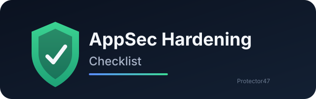

<p align="center">
  
</p>

<p align="center">
  <a href="https://github.com/Protector47/appsec-hardening-checklist/actions/workflows/ci.yml"></a>
  <a href="LICENSE"></a>
</p>

# AppSec Hardening Checklist

Practical hardening checklists for web apps, APIs, cloud, identity, CI/CD, and logging. Each item says what to check, why it matters, and what a secure default looks like.

## The problem

Most security reviews fail in the same places: a cookie without `HttpOnly`, an API that trusts the object ID in the URL, a CI job with an admin cloud key, logs that contain session tokens. Teams usually know these rules. They just do not have a short list to check against when it counts.

Standards like OWASP ASVS and the CIS Benchmarks are thorough but long. This repo is the shorter version you can actually get through in a design review or before a release. It links to the standards where you need more depth.

## Contents

| Checklist | Covers |
| --- | --- |
| [Web apps](checklists/web-apps.md) | TLS, cookies, security headers, sessions, output encoding, uploads, third-party scripts |
| [APIs](checklists/apis.md) | Token validation, object and function level authorization, schemas, rate limits, GraphQL limits |
| [Cloud](checklists/cloud.md) | Account structure, IAM, storage exposure, encryption, network, metadata, audit logs |
| [Identity](checklists/identity.md) | SSO, password storage, MFA, account recovery, sessions, access reviews |
| [CI/CD and supply chain](checklists/cicd-supply-chain.md) | Branch protection, pipeline tokens, action pinning, dependencies, signing, SBOMs |
| [Logging and monitoring](checklists/logging-monitoring.md) | What to log, what not to log, log integrity, retention, alerting |

Also included:

- [Sample web app review](examples/sample-web-review.md): a filled-in review with findings and follow-up tickets
- [Using in your SDLC](docs/using-in-sdlc.md): where these checklists fit in design reviews, PRs, and release gates

## Checklist format

Every item follows the same layout:

```markdown
- [ ] **Item name**: What to check.
  - **Why it matters:** The failure this prevents.
  - **Secure default:** A concrete setting or pattern to start from.
```

## How to use

1. Pick the checklists that match the system you are reviewing.
2. Copy them into your repo or ticket, for example `docs/security/review-2026-11.md`.
3. Tick items that pass. For items that fail, open a ticket with an owner and due date.
4. Mark items that do not apply as N/A with a one-line reason.
5. Keep the completed review in version control so the next review has something to compare against.

See [examples/sample-web-review.md](examples/sample-web-review.md) for what a finished review looks like.

## Scope

This repo is defensive only. It covers configuration, design, and process controls. It does not include exploit code, attack payloads, or scanning tools.

## References

- [OWASP ASVS](https://owasp.org/www-project-application-security-verification-standard/)
- [OWASP Cheat Sheet Series](https://cheatsheetseries.owasp.org/)
- [OWASP API Security Top 10](https://owasp.org/API-Security/)
- [CIS Benchmarks](https://www.cisecurity.org/cis-benchmarks)
- [NIST SP 800-63B](https://pages.nist.gov/800-63-4/sp800-63b.html)
- [SLSA](https://slsa.dev/)

## Contributing

Fixes and additions are welcome. Read [CONTRIBUTING.md](CONTRIBUTING.md) first.

## License

[MIT](LICENSE)

---

Maintained by [Protector47](https://github.com/Protector47) · <https://www.protector47.com/>
